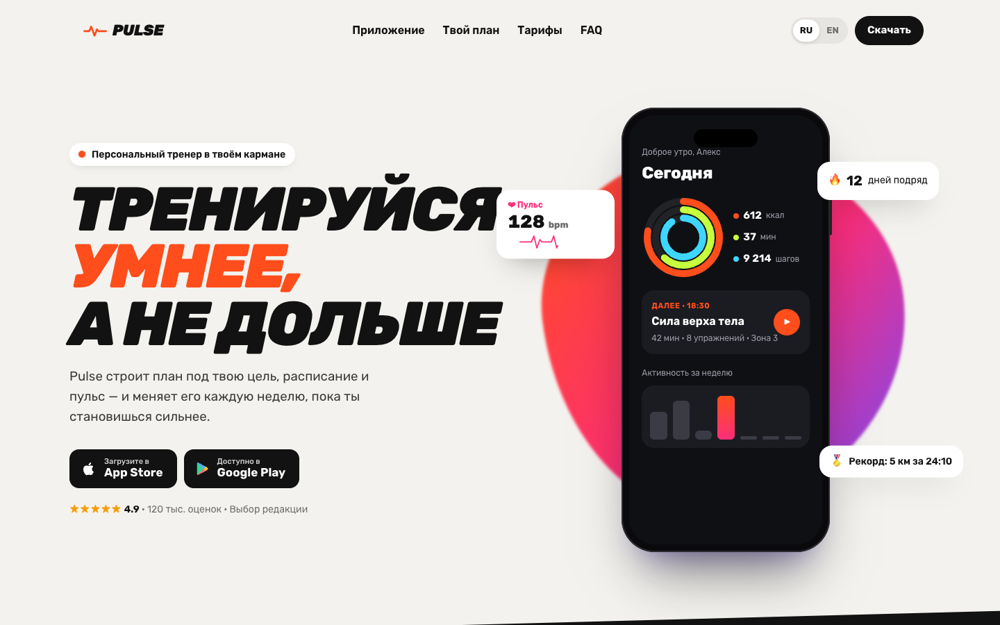
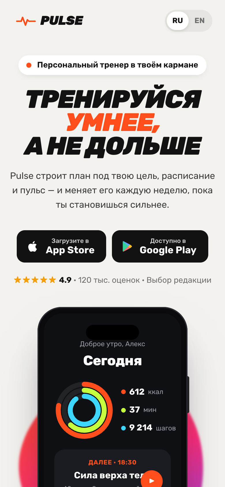

<div align="center">

# Pulse

**Лендинг фитнес-приложения** · RU / EN

<a href="https://cdduke.github.io/pulse-fitness/"></a>

    

&nbsp;

*🇬🇧 Fitness app landing — pure-CSS phone mockup with live UI, sticky scroll storytelling and an interactive training-plan generator.*

</div>

---

Концепт промо-сайта мобильного фитнес-приложения: энергичная типографика, **макет телефона, собранный на CSS**
с «живым» интерфейсом внутри, и сторителлинг, в котором экраны приложения меняются вместе с прокруткой текста.
**Двуязычный: русский (по умолчанию) и английский.**

**Стек:** Vite · TypeScript (strict) · GSAP ScrollTrigger · Lenis · CSS (без изображений — всё на HTML/CSS/SVG)

## Что внутри

- **Hero**: CSS-телефон с кольцами активности (SVG `pathLength` + анимация заполнения), карточкой тренировки,
  мини-графиком недели; плавающие виджеты — пульс с бегущей ЭКГ, серия дней, рекорд; «живой» блоб на фоне
- **Scroll-сторителлинг**: телефон закреплён (`position: sticky`), 4 экрана — план недели, тренировка с таймером
  и пульсовыми зонами, прогресс (анимированные столбцы), рейтинг друзей — переключаются по мере чтения текста
- **Генератор плана тренировок**: цель, уровень и количество дней → неделя с типами тренировок, длительностью,
  интенсивностью, итоговым временем, калориями и фокусом (детерминированный алгоритм)
- Тарифы с переключением месяц/год и анимацией цены, FAQ на `<details>`, счётчики, бегущая строка
- Локализация: тексты, план, валюта (`Intl`), «млн» в счётчиках

## Адаптивность и доступность

- Проверено на 390px и 1440px (headless Chrome); на телефоне закреплённый макет уменьшается и остаётся сверху
- `prefers-reduced-motion`: анимации отключаются
- Радиокнопки и слайдер в генераторе — нативные элементы формы с видимым фокусом

## Запуск

```bash
npm install
npm run dev      # http://localhost:5180
npm run build    # tsc + сборка
```

---

*Concept app landing built as a portfolio piece. Bilingual: Russian / English.*


**Демо:** https://cdduke.github.io/pulse-fitness/
